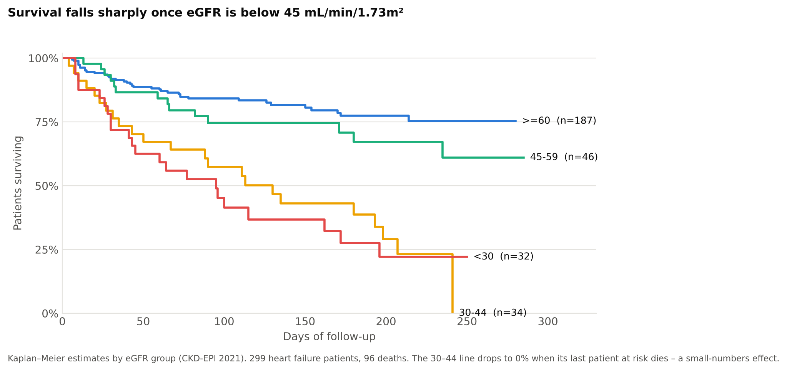
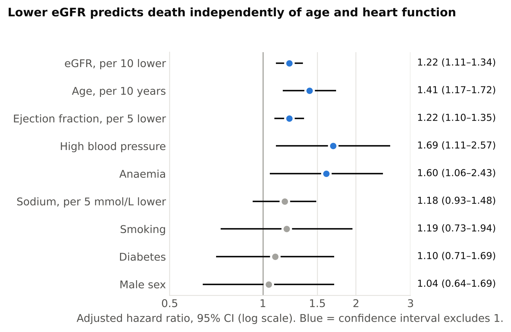

# Kidney Function and Survival in Heart Failure

**Does reduced kidney function predict death in heart failure patients, independently of age and heart function?**

**Author:** Afolasewa Duduyemi · **Tools:** R (survival, dplyr, ggplot2, broom) · **Methods:** eGFR derivation (CKD-EPI 2021), Kaplan–Meier, log-rank test, Cox proportional hazards regression, sensitivity analysis

## Headline findings

| | Result |
|---|---|
| **Patients** | 299 adults with heart failure; 96 died during follow-up (4–285 days) |
| **Kidney function** | Median eGFR 68 mL/min/1.73m²; 112 patients (37%) below 60 |
| **Unadjusted risk** | Patients with eGFR below 30 died at about 5 times the rate of those at 60 or above (HR 4.79, 95% CI 2.82–8.13) |
| **Adjusted risk** | Each 10 mL/min/1.73m² lower eGFR → **22% higher hazard of death** (HR 1.22, 1.11–1.34), after adjusting for age, sex, ejection fraction, sodium, anaemia, diabetes, blood pressure and smoking |
| **Where the risk sits** | The association is concentrated below eGFR 60 (HR 1.32 per 10 lower) and not clear above it (HR 1.09, 0.90–1.32) |
| **Robustness** | Unchanged after dropping 19 patients whose creatinine values appear to be filled in (HR 1.21, 1.10–1.33) |



### Mortality by kidney function

| eGFR (mL/min/1.73m²) | Patients | Deaths | % died | Deaths per 100 person-years | Adjusted HR (95% CI) |
|---|---|---|---|---|---|
| 60 or above | 187 | 37 | 19.8% | 52 | 1 (reference) |
| 45–59 | 46 | 14 | 30.4% | 80 | 1.38 (0.73–2.61) |
| 30–44 | 34 | 23 | 67.6% | 228 | 2.58 (1.44–4.63) |
| Below 30 | 32 | 22 | 68.8% | 268 | 3.85 (2.12–6.99) |

Log-rank test across the four groups: χ² = 55.8, 3 df, p < 0.001.



## Why this matters

Heart and kidney disease feed each other (the "cardio-renal" link). These results show that a routine
blood test – serum creatinine, converted to eGFR – adds prognostic information beyond age and ejection
fraction. In practice, patients with heart failure and an eGFR below 45 are a high-risk group who may
need closer follow-up.

## Data

- **Heart Failure Clinical Records** (UCI Machine Learning Repository, [dataset 519](https://archive.ics.uci.edu/dataset/519/heart+failure+clinical+records)),
  licensed CC BY 4.0. Included in `data/`.
- Medical records of 299 patients with left ventricular systolic dysfunction (NYHA class III–IV), aged 40+,
  at the Institute of Cardiology and Allied Hospital, Faisalabad, Pakistan, April–December 2015.
- Original study: Ahmad T, Munir A, Bhatti SH, Aftab M, Raza MA (2017). Survival analysis of heart failure
  patients: a case study. *PLoS ONE* 12(7): e0181001.
- Dataset curation: Chicco D, Jurman G (2020). *BMC Medical Informatics and Decision Making* 20:16.

### Data quality checks

| Check | Rows | How I handled it |
|---|---|---|
| Platelets exactly equal to the column mean (263,358.03) | 25 | Flagged as likely mean-imputed; platelets not used in models |
| Creatinine phosphokinase equal to 582 (the rounded mean) | 47 | Flagged; not used in models |
| Serum creatinine of exactly 1.18 or 1.83 mg/dL, often alongside the imputed values above | 19 | Kept in main analysis; removed in a sensitivity analysis |
| Non-integer age (60.667) | 2 | Kept |

No missing values or duplicate rows.

## Method

1. **eGFR** from serum creatinine (mg/dL), age and sex using the race-free CKD-EPI 2021 equation; grouped
   into ≥60, 45–59, 30–44 and <30 (standard CKD stage cut-points).
2. **Descriptive survival:** deaths and mortality rate per 100 person-years by group; Kaplan–Meier curves; log-rank test.
3. **Cox proportional hazards models** (Efron ties): eGFR unadjusted, then adjusted for age, sex, ejection
   fraction, serum sodium, anaemia, diabetes, high blood pressure and smoking; eGFR as a continuous term and as groups.
4. **Checks:** proportional-hazards test (`cox.zph`), a piecewise term to test linearity around eGFR 60,
   and a sensitivity analysis excluding suspected imputed creatinine values.

| Step | Script |
|---|---|
| Data checks and eGFR | `R/01_prepare_data.R` |
| Mortality tables, Kaplan–Meier, log-rank | `R/02_survival_descriptives.R` |
| Cox models, checks, forest plot | `R/03_cox_models.R` |

## Limitations

- **Small, single-centre sample** (299 patients, 96 deaths) – wide confidence intervals, especially in the smaller eGFR groups.
- **Observational data** – associations, not causes; unmeasured factors (medication, cause of heart failure) are not available.
- **Short, uneven follow-up** (4–285 days) – survival late in follow-up rests on few patients.
- **eGFR from one creatinine reading** – clinical CKD staging requires two readings at least 3 months apart.
- **Age enters twice** – age is part of the eGFR equation and also a model covariate; replacing eGFR with log serum
  creatinine gives the same conclusion (HR 2.57 per log unit, 1.72–3.85).

## How to run

```r
# from the project folder
source("run_all.R")   # installs missing packages, writes tables and charts to outputs/
```

## Repository structure

```
├── run_all.R
├── R/                 # analysis scripts, run in order
├── data/              # Heart Failure Clinical Records (CC BY 4.0)
├── docs/
│   ├── heart_failure_summary.pdf   # one-page brief
│   └── figures/
└── outputs/           # generated tables and charts (not tracked)
```
